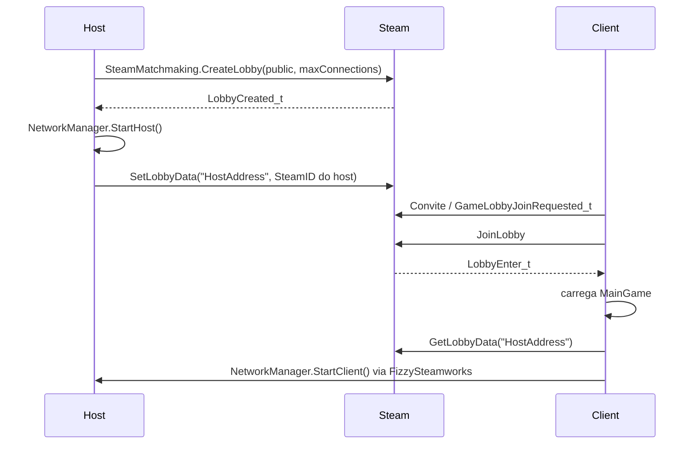
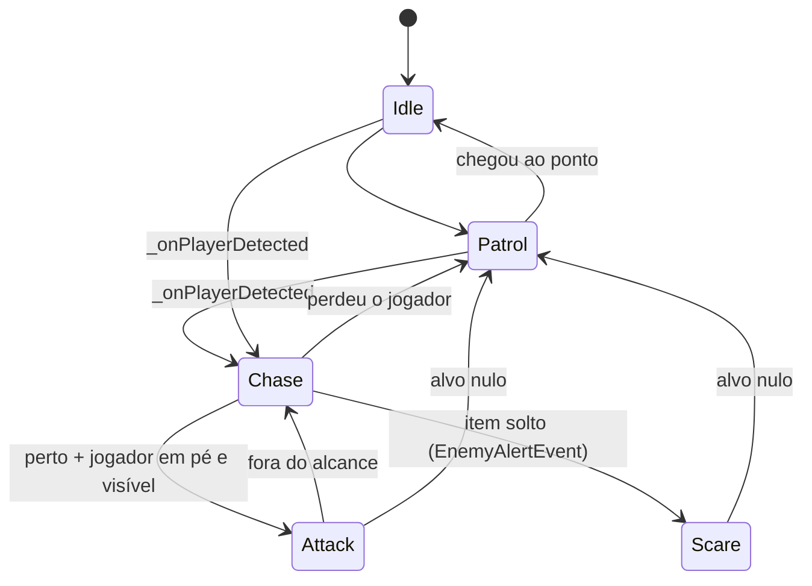

# piFromFour

Jogo 3D **cooperativo online em primeira pessoa**, com stealth e puzzles, feito em Unity 6 (URP). Os jogadores entram juntos por um **lobby da Steam**, exploram o mapa evitando um inimigo controlado por IA (agachar tira o jogador do campo de visão), conversam com NPCs, carregam itens e resolvem interações que precisam dos dois jogadores ao mesmo tempo.

A rede usa **Mirror** com servidor autoritativo e transporte **FizzySteamworks** (P2P pela Steam). Há também um prefab com **KCP** para testes locais.

---

## Stack

| | |
|---|---|
| Engine | **Unity 6000.0.53f1** |
| Render | **URP 17.0** + Shader Graph |
| Rede | **Mirror** (Commands, ClientRpc, TargetRpc, SyncVar com hooks, NetworkTransform) |
| Transporte | **FizzySteamworks** (Steam P2P) / **KCP** (testes) |
| Plataforma | **Steamworks.NET** (`SteamManager`, Matchmaking, Lobbies), `steam_appid.txt` = 480 (Spacewar, app de testes da Valve) |
| IA | **AI Navigation** (NavMesh + NavMeshAgent) |
| Animação | Animation Rigging (IK de mãos e cabeça), camadas do Animator |
| Input | **Input System 1.14** (classe gerada `InputSystem_Actions`) |
| Localização | **Unity Localization 1.5**, tabelas `en` e `pt-BR` |
| Testes de multiplayer | **ParrelSync** (clones do projeto para rodar host e client no mesmo PC) |
| Outros | Cinemachine 2, ProBuilder, Burst, Collections, Mathematics, Newtonsoft JSON |

---

## Arquitetura

Código próprio em `Assets/Scripts`. O resto de `Assets` é formado por SDKs e assets de terceiros (Mirror, Steamworks.NET, ParrelSync, MeshCombiner, Painterly, Volumetric Fog, modelos e animações).

```
Assets/Scripts
├── Steam            # SteamLobby: criação/entrada em lobby + handshake do endereço do host
├── Steamworks.NET   # SteamManager (inicialização da API)
├── Multiplayer      # StartSteamHost, PlayersConnectedStart, PlayerConnected
├── Player           # Estado, movimento, câmera, IK e features de interação (NetworkBehaviours)
├── Interaction      # IInteraction + tipos de interagíveis sincronizados
├── Enemy / enemy    # FSM do inimigo + percepção (SearchPlayer)
├── GameController   # Objetivos e spawn de itens no servidor
├── Inputs           # HandleInputs + InputSystem_Actions gerado
└── Menu
```

### Fluxo de conexão pela Steam



- `SteamLobby` espera o `SteamManager` inicializar em uma coroutine antes de registrar os `Callback<T>` da Steam, o que evita chamadas na API antes da hora.
- O **SteamID do host** vai como metadado do lobby e é usado como `networkAddress` pelo transporte FizzySteamworks. Não há IP exposto nem necessidade de abrir portas.
- `StartSteamHost` cria o lobby automaticamente ao entrar na cena, mas só se ainda não houver conexão ativa (`NetworkClient.isConnected || NetworkServer.active`).
- `PlayersConnectedStart` replica a contagem de conexões por `SyncVar` com hook e faz fade de UI quando o segundo jogador entra.

### Modelo de autoridade

- **Servidor autoritativo** para tudo o que é estado do mundo: percepção e FSM do inimigo, interagíveis, objetivos e spawn de itens (`if (!isServer) return;`, `[Server]`).
- **Client-side** só para o que é do jogador local: input, câmera, movimento com `CharacterController` (`if (!isLocalPlayer) return;`).
- Interações seguem o padrão **Command → validação no servidor → ClientRpc**, com `[Command(requiresAuthority = false)]` para que qualquer jogador possa interagir com objetos de cena que ele não possui.
- `TargetRpc` para efeitos que valem só para um cliente, como teleportar um jogador específico.
- Componentes de apresentação são desligados em jogadores remotos: câmera (`HandleCamera`) e peso do Rig de IK (`DeactiveRigWhenNotLocal`).

### Sistema de interação

Interface única, `IInteraction.interactived(NetworkIdentity caller)`. O jogador local faz um raycast da câmera (`CallInteractivedObj`) e chama a implementação do objeto atingido:

| Componente | Comportamento | Sincronização |
|---|---|---|
| `ObjectInteractable` | Pegar, segurar e soltar. Prende o objeto ao osso da mão, deixa o Rigidbody kinematic e liga a camada de animação de "segurar" | Command valida a posse (um portador por vez) → ClientRpc aplica em todos |
| `UseOnTargetInteractable` | Usa o item segurado em um alvo, com filtro por tag (ex.: `Gas`) e depois destrói o item na rede | `NetworkServer.Destroy` após o `DropObj` |
| `DoubleInteractable` | Precisa de **dois jogadores** em dois pontos pareados ao mesmo tempo. Trava a câmera (`TargetLock`) e o movimento enquanto ativo | `SyncVar` com hook verifica o par |
| `MashButtonInteractable` | Barra de progresso por apertos repetidos, com decaimento contínuo no servidor | Progresso em `SyncVar` (0 → 1) + Rpc de conclusão |
| `HumanDialogueInteractable` | Diálogo com NPC por proximidade, exibido no canvas do jogador local | Local por jogador |
| `ClickInteractable`, `SwitchInteractable`, `ButtonInteractable` | Variações de botão, alavanca e clique com câmera guiada | `UnityEvent`s configuráveis no Inspector |

Todos expõem `UnityEvent`s (`ActionWhenStartHold`, `onMashButtonCompleted`, `isInteractivedFinish`…), então portas, baús e alavancas são montados no Inspector sem código novo (veja `Interaction/ExampleInteracteived`).

`ObjetiveComplete` verifica no servidor quando todos os `UseOnTargetInteractable` foram usados e dispara a transição de cena em todos os clientes.

### Jogador

- `SimpleStatePlayer`: FSM com enum (`Idle`, `Walking`, `Running`, `Crouching`, `Interacting`). Ajusta altura e centro do `CharacterController` e usa um **`OverlapCapsule`** acima da cabeça para impedir que o jogador levante embaixo de obstáculos (`ICanStandUp`, em `SyncVar`, também lido pela IA).
- `HandleMoviment`: movimento relativo à câmera no plano XZ + gravidade.
- `HandleCamera`: câmera em primeira pessoa com modos `FreeLook`, `TargetLock` e `LockedCursorFree`. Yaw fica no corpo, pitch na câmera, com clamp.
- `PlayerInteractivedFeatures`: move jogador ou câmera até pontos de interação e recebe `TargetRpc` de teleporte.
- IK com **Animation Rigging** (`TargetHandfollowCam`) e camada de animação de "segurar" ponderada por `AnimationPickUpWeight`.

### IA do inimigo

FSM baseada em interface (`States`: `enterState` / `updateState` / `exitState`), gerenciada por `StateManagerEnemy` e executada no servidor:



**Percepção (`SearchPlayer`)**:

1. `OverlapSphere` na layer dos jogadores dentro do raio de visão.
2. Filtro por **faixa de altura** e **cone de visão** (componente `z` da direção em espaço local comparada a um limiar configurável).
3. **Raycast de oclusão**: só conta se o primeiro hit for o jogador.
4. **Jogador agachado em esconderijo** (`!ICanStandUp`) é ignorado, e quem já estava sendo perseguido é "perdido" depois de 0,5 s.
5. *Memória*: depois de perder a visão, o inimigo segue a última posição conhecida por `timerToLosePlayer` segundos antes de desistir.
6. Gizmos de editor (`Handles.DrawWireDisc`) desenham o cone e a faixa de altura.

Pontos de patrulha ficam em um `PointList` com **inspector customizado** (`Editor/GIDPoints.cs`) para editar os pontos na cena.

### Spawn e objetivos

- `SpawnPimenta`: o servidor mantém até 3 itens vivos, spawnando em pontos aleatórios com `InvokeRepeating` + `NetworkServer.Spawn`.
- `ObjetiveComplete`: condição de vitória agregada com LINQ (`All(i => i.Used)`) → `ClientRpc` → `SceneManager.LoadScene`.

### Localização

Unity Localization com String Table `tableLocalization` em **inglês** e **português (pt-BR)** (`Assets/Localization`).

### Performance e arte

- **MeshCombiner** (editor + runtime) para juntar malhas estáticas e reduzir draw calls, com suporte a malhas acima do limite de 16 bits.
- Shader Graphs **Painterly** (Lit com normais pintadas via Custom Function HLSL) e **Volumetric Fog** em URP.
- Testes de shader e ondas em `Assets/Scenes/testes` e `Assets/Scenes/learn`.

---

## Cenas

| Cena | Função |
|---|---|
| `Assets/Scenes/MainMenu.unity` | Menu e criação/entrada no lobby (build index 0) |
| `Assets/Scenes/MainGame.unity` | Fase principal (build index 1) |
| `Assets/Scenes/Multiplayer.unity` | Testes de rede |
| `Assets/Scenes/Blockout.unity` | Blockout do level design |

## Como rodar

1. Abra o projeto com **Unity 6000.0.53f1**.
2. Deixe o **cliente Steam aberto e logado**. O `steam_appid.txt` aponta para o app 480 (Spacewar), usado para desenvolvimento.
3. Abra `Assets/Scenes/MainMenu.unity` e dê Play para hospedar. O outro jogador entra pelo convite da Steam.

### Testando host e client na mesma máquina

- Use **ParrelSync** (`ParrelSync > Clones Manager`) para criar um clone do projeto e abrir uma segunda instância do Editor.
- Para testes sem Steam, use o prefab `prefabs/MultiplayerPrefabsTesters/--networkManagerKCP.prefab` (transporte KCP/UDP) no lugar de `NetworkManagerSteam.prefab`.

## Créditos de terceiros

Mirror, FizzySteamworks, Steamworks.NET, ParrelSync, MeshCombiner, Painterly, Mirza Beig – Volumetric Fog (Lite), Kevin Iglesias – Basic Motions, Free Stylized Skybox, BookHeadMonster, NPC Casual Set e Unity Technologies (Robot Kyle). Cada um segue a licença incluída na própria pasta.
